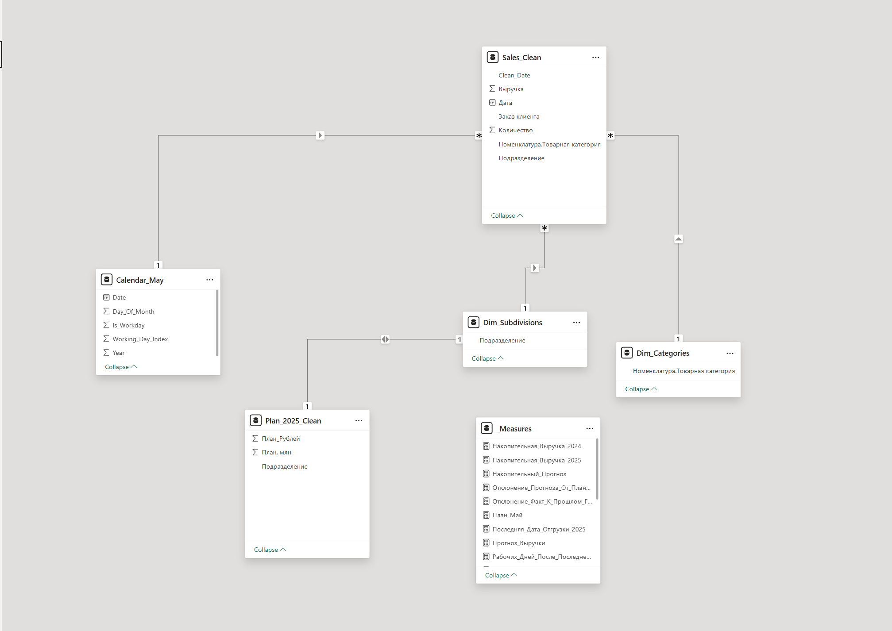
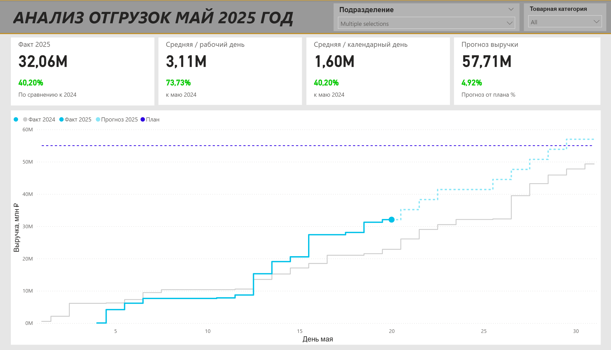
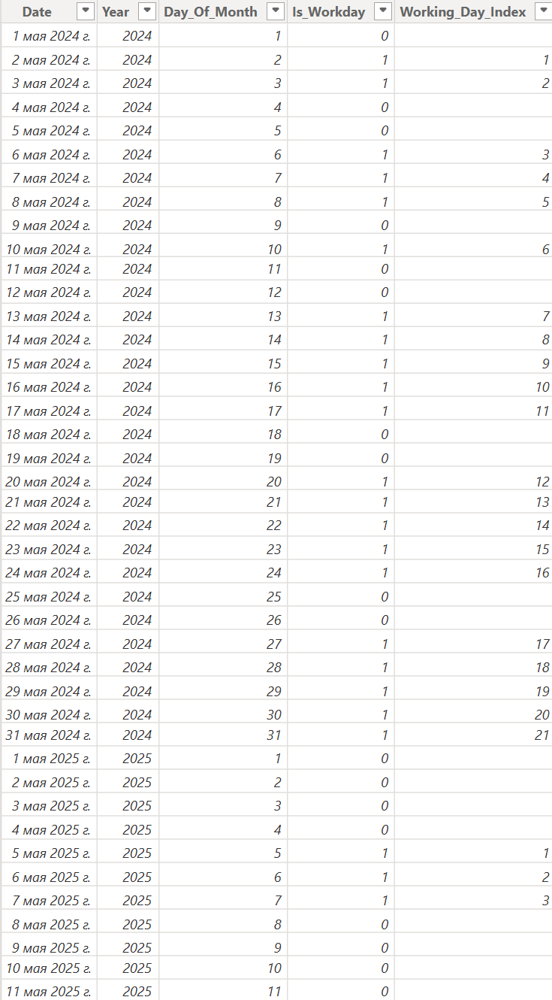

# Анализ отгрузок и прогнозирование продаж

##  О проекте
Аналитический проект по исследованию и сравнению отгрузок за май 2024 и май 2025 годов. На основе исторических данных, производственного календаря РФ (с учетом праздников и сокращенных рабочих дней) и плановых показателей построена интерактивная система мониторинга ключевых бизнес-метрик в Power BI.

<table>
  <tr>
    <td width="33%" align="center">
      
       
      <em>Схема данных и связей</em>
    </td>
    <td width="33%" align="center">
      
       
      <em>Главная страница дашборда (YTD и прогноз)</em>
    </td>
    <td width="33%" align="center">
      
       
      <em>Производственный календарь (май)</em>
    </td>
  </tr>
</table>

---

##  Стек и инструменты
* **Язык:** Python (Pandas) — *ETL, обработка исходных файлов, расчет календаря рабочих дней.*
* **Инструменты BI:** Power BI, DAX — *разработка интерактивного дашборда, расчет YTD-метрик и прогнозов.*
* **Формат данных:** Excel (планы, отчеты по отгрузкам, производственный календарь).

---

##  Что реализовано на дашборде:
1. **Накопительный график продаж («лесенка»):** Сравнение подневной динамики выручки 2024 и 2025 годов с фильтрацией по актуальным дням.
2. **Сравнительный анализ (YTD):** Оценка темпов продаж текущего периода к прошлым годам (в процентах по рабочим и средним дням).
3. **Прогноз до конца месяца:** Автоматический расчет ожидаемой итоговой выручки на основе текущих отгрузок с расчетом отклонения от плана (`Plan 2025`).
4. **Интерактивные срезы:** Фильтрация данных в разрезе **Товарных групп** и **Подразделений**.

---

##  Структура репозитория
* `notebooks/` — скрипты предобработки данных и формирования календаря на Python.
* `datasets/` / `data/` — исходные и очищенные файлы отчетов.
* `*.pbix` — файл готового дашборда Power BI.